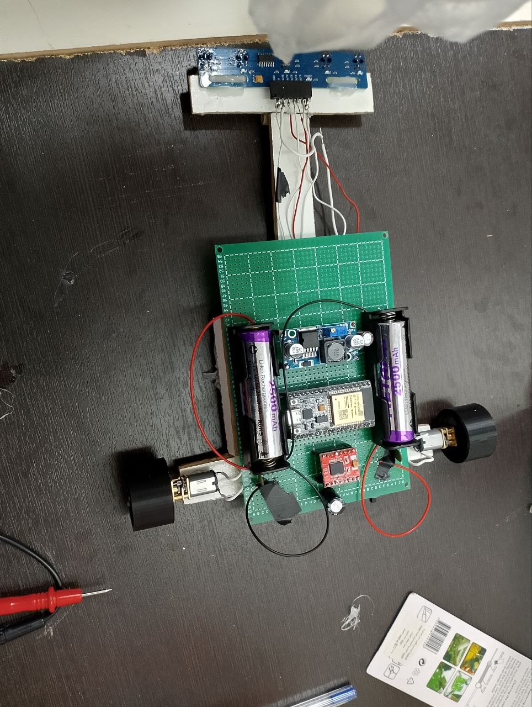
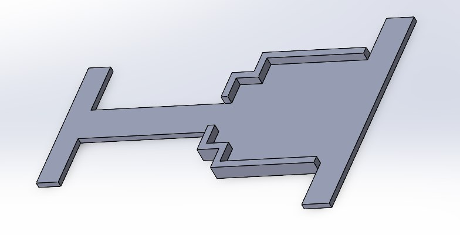
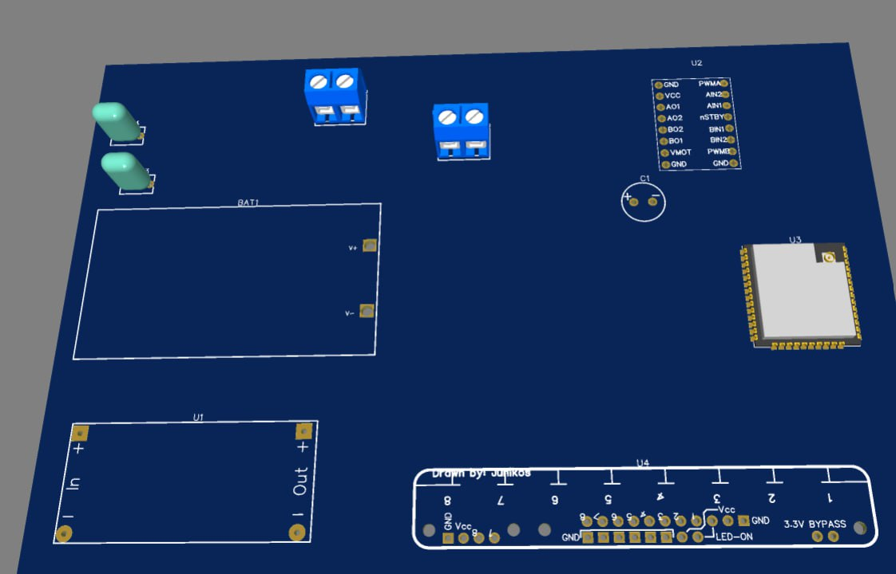

# EDJ Runner — ESP32 Line Follower

A fast line-following robot built on an **ESP32** with **ESP-IDF** and **FreeRTOS**.
It uses a 5-sensor analog reflectance array, a PID steering loop, and automatically
handles a **reversed zone** (white line on a dark floor).

روبوت تتبّع خط مبني على **ESP32** باستخدام **ESP-IDF** و**FreeRTOS**، بحساسات تناظرية
وتحكم PID، ويكتشف تلقائيًا **المنطقة المعكوسة** (خط أبيض على أرضية داكنة).

> **Status:** firmware tested on the real robot (perfboard prototype). The schematic is in
> [`hardware/`](hardware/); the PCB layout is a work in progress (3D draft below).

---

## Features

- Two FreeRTOS tasks pinned to separate cores: sensors on core 0, control on core 1.
- PID steering with a leaky integral (decay 0.90) and a safety clamp.
- Automatic reversed-zone detection with debounce (4+ sensors seeing the line to enter, 1 or fewer to leave).
- Line-lost recovery: spins toward the side where the line was last seen.
- Slows down on sharp turns when an outer sensor sees the line strongly.
- Shared data between cores uses `std::atomic`; ADC read errors are handled.
- 3-second start delay so you can place the robot on the track.

## Photos

| Prototype (perfboard) | Chassis design (SolidWorks) |
|---|---|
|  |  |

PCB 3D draft (component placement, not final):



## Hardware

| Part | Notes |
|---|---|
| MCU | ESP32-WROOM-32UE (U3) |
| Motor driver | TB6612FNG dual motor driver carrier (U2) |
| Motors | 2 × DC motors with 15 nF suppression capacitors |
| Sensors | 5-channel analog reflectance array (see note below) |
| Regulator | LM2596 module (U1) |
| Battery | BC9VPC pack with a 1000 µF bulk capacitor |

### Pin map

| Function | GPIO |
|---|---|
| Left motor PWM / IN1 / IN2 | 18 / 19 / 21 |
| Right motor PWM / IN1 / IN2 | 25 / 22 / 23 |

| Sensor (code index) | Schematic net | GPIO | ADC1 channel |
|---|---|---|---|
| 0 (far left in code) | `5qtrpin` | 36 (VP) | CH0 |
| 1 | `4qtrpin` | 39 (VN) | CH3 |
| 2 | `3qtrpin` | 34 | CH6 |
| 3 | `2qtrpin` | 35 | CH7 |
| 4 | `1qtrpin` | 32 | CH4 |

Note: the code index order is the **reverse** of the schematic net names
(`5qtrpin` is sensor 0). Keep this in mind when wiring.

### Hardware notes

Please check these against your own build before copying the design:

- The schematic symbol is a QTR-8RC, but the firmware reads **analog** values through the ADC.
  Use an analog array (for example a 5-channel QTR-A type).
- The `VCC` pin of the TB6612 board (logic supply) must be powered (3.3 V or 5 V).
- Confirm the LM2596 module output voltage matches what it feeds (the ESP32 3V3 rail needs 3.3 V).
- All grounds (driver, regulator, sensors) must share the battery negative.

## Build and flash

Requires [ESP-IDF](https://docs.espressif.com/projects/esp-idf/) 5.x (uses `esp_adc/adc_oneshot`).

```bash
idf.py set-target esp32
idf.py build flash monitor
```

On power-up the robot waits 3 seconds (`START_DELAY_MS`) before moving.

## How it works

1. **SensorTask** (core 0, every 10 ms) reads the 5 ADC channels, computes a weighted
   position from 0 to 4000 (center = 2000), and detects the reversed zone.
2. **ControlTask** (core 1, every 10 ms) turns the position error into a PID correction
   and drives the two motors: `left = base + pid`, `right = base - pid`.
3. In the **reversed zone** the base speed is lower (×0.85) and the PID output is scaled (×0.8).
4. If **no sensor** sees the line, the robot spins in place toward the last known side.

## Tuning

All parameters are `constexpr` constants at the top of `main/main.cpp`.

| Constant | Default | Effect |
|---|---|---|
| `Kp` | 0.075 | Main steering strength. Raise if it reacts too slowly. |
| `Ki` | 0.0001 | Corrects steady drift. Keep very small. |
| `Kd` | 0.60 | Damping. Raise if it oscillates. |
| `BASE_SPEED_L/R` | 100 | Base speed. If the robot drifts on a straight line, adjust one side by a few units. |
| `NORMAL_SPEED_FACTOR` | 1.15 | Speed multiplier on normal track. |
| `REVERSED_SPEED_FACTOR` | 0.85 | Speed multiplier in the reversed zone. |
| `REVERSED_PID_SCALE` | 0.80 | PID scaling in the reversed zone. |
| `SENSOR_THRESHOLD` | 700 | Readings below this are ignored. |
| `REVERSE_DEBOUNCE_CYCLES` | 10 | Cycles needed to confirm a zone change (lower = faster, but risks false triggers at junctions). |

Tip: change one value at a time and test the reversed zone first.

## Known limitations

- Wide black patches or junctions can look like a reversed zone to the detector; the debounce reduces but does not remove this.
- The derivative is not divided by the loop period, so changing the loop time requires re-tuning the PID.
- Both motors are assumed identical; there is no calibration step.

## Repository layout

```
main/            firmware (main.cpp)
hardware/        schematic (PCB in progress)
docs/images/     photos and renders
CMakeLists.txt   ESP-IDF project file
```

## License

MIT — see [LICENSE](LICENSE).

---

## نبذة بالعربية

**EDJ Runner** روبوت تتبّع خط سريع مبني على ESP32. تعمل قراءة الحساسات على النواة 0
والتحكم بالمحركات على النواة 1. يستخدم PID للتوجيه، ويكتشف تلقائيًا الأرضية المعكوسة
(خط أبيض)، ويستعيد الخط إذا فُقد بالدوران نحو آخر جهة شوهد فيها.

**البناء:** ثبّت ESP-IDF 5.x ثم نفّذ `idf.py set-target esp32` ثم `idf.py build flash monitor`.

**الضبط:** كل المعاملات ثوابت في أعلى الملف `main/main.cpp`. غيّر قيمة واحدة في كل مرة،
واختبر المنطقة المعكوسة أولًا.

**تنبيه التوصيل:** ترتيب الحساسات في الكود معكوس عن أسماء الأطراف في المخطط
(`5qtrpin` هو الحساس رقم 0).
